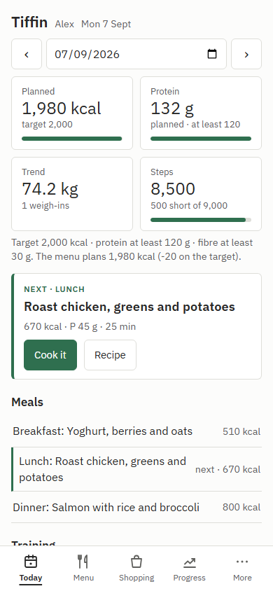
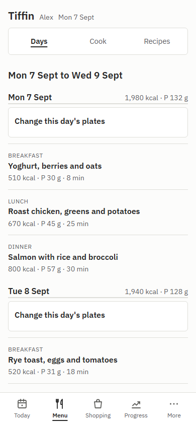
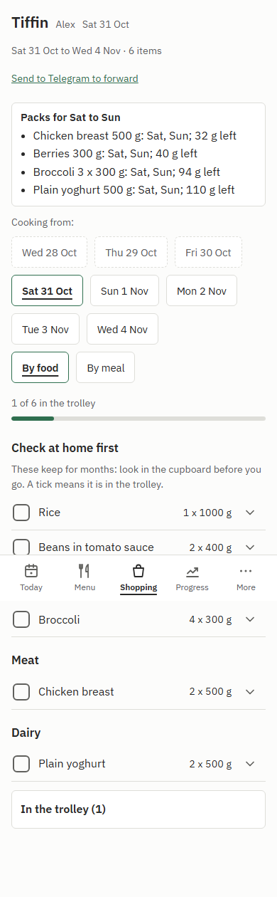
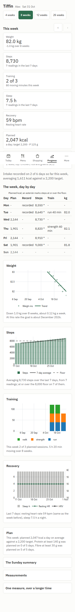
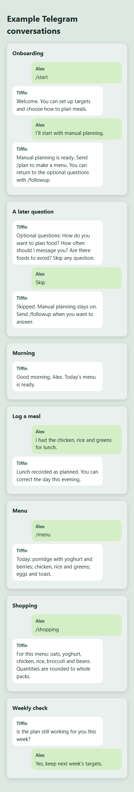
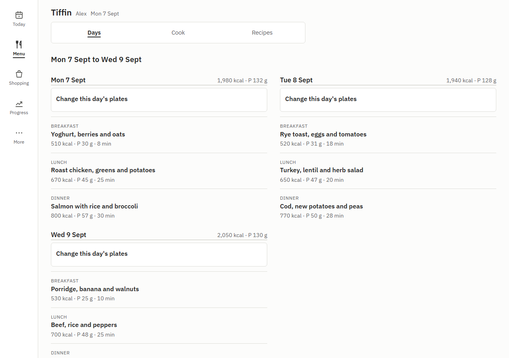

# Tiffin

Tiffin is a self-hosted nutrition, menu, shopping and training app for one person or a household of two. It runs a Telegram bot, scheduled jobs and an optional web page in one Python process, with a SQLite database in your own data directory.

**Status: early, 0.1.0.**

## What it does

- Plans meals from your own energy and nutrient targets, then calculates portions from ingredient data in code.
- Builds aisle-sorted, pack-aware shopping lists from the included catalogue, keeps track of what is already at home and supports batch cooking. No browser, retailer, product link or price is required.
- Offers weekly dish choices, recipe cards and shared weekend menus for two linked people (a link code one makes and the other enters; either can unlink at any time), with separate portions and private targets. An install holds two people at most.
- Logs meals and daily confirmations through Telegram, including off-plan meals and corrections.
- Reads Garmin-linked activity and wellness data through intervals.icu; shows training, weight trends, progress and tape measurements.

The AI model suggests or selects from numbered candidates. It does not calculate nutrients. Each person decides whether their data may be sent to the configured model provider; without consent or a model, model-assisted work becomes manual.

The web page lets you add recipes and plan meals yourself from catalogue foods. With the page off, `/plan` in Telegram provides the same manual recipe, menu and shopping path. Saving a manual menu calculates its nutrient totals and shopping list without an AI model.

## Screenshots

| Today | Menu | Shopping | Progress | Telegram |
| --- | --- | --- | --- | --- |
|  |  |  |  |  |

<p align="center">
  
</p>

[Browse every screen](docs/screenshots.md), or run `uv run tiffin demo` to explore the web page with made-up data. Today and Menu use the same fictional captures as the portfolio; the other screen captures use the disposable demo. The demo needs no bot, model key or network connection and deletes its data when stopped. To make local screenshots, run `python tools/screenshots.py` after installing Playwright and its Chromium browser.

## Quick start

Install Python 3.14 and [uv](https://docs.astral.sh/uv/), then from this checkout:

```sh
uv sync
uv run tiffin setup
```

`tiffin setup` is a guided set-up in eight steps: your folder and time zone, who will use Tiffin, your Telegram bot (made with @BotFather, checked with Telegram, then your chat paired by a one-time code), an AI model or none, intervals.icu for training data, the optional web page, supermarket products, and a review before anything is saved. It checks each answer as it goes, never shows a token or key, loads the food list, runs the same checks as `tiffin doctor` and ends with what to do next: start Tiffin with `uv run tiffin run` and send `/start` to your bot.

Run `tiffin setup` again at any time: it shows what is set and changes one part, such as `uv run tiffin setup web`, keeping everything else in `tiffin.toml` as it was. `tiffin init` and `tiffin connect <part>` run the same set-up.

The catalogue supplies typical unbranded packs. To use a product you buy instead, open a shopping line on the page and choose **Use my product**, or run `uv run tiffin product add chicken_breast "Chicken breast 500 g" --pack-g 500`. Price, shop and HTTPS link are optional. Your product is used on future lists; each person's entries are private.

The bundled food data and optional retailer readers are UK based. GB is the supported country for the food catalogue; other country settings are accepted, with a setup warning, but their food names and packs are not validated.

For Docker, set up the persistent volume, then start the service:

```sh
docker compose run --rm tiffin tiffin setup
docker compose up -d --build
```

For a scripted install, give the answers as flags and the secrets as environment variables, and nothing is asked:

```sh
docker compose run --rm tiffin tiffin setup --non-interactive --owner-name Alex --timezone Europe/London --web-mode off --model-provider none --pair later
```

The compose file passes the bot token in as `TIFFIN_TELEGRAM_TOKEN_FILE`. With `--pair later` setup prints a one-time code to send to your bot once the service is running; without it, setup waits for that code. A missing or wrong answer stops it with exit code 2 before anything is written. See [Docker setup](docs/deployment.md#docker) for details. The image contains the Claude CLI (give it a token as the compose file explains), or choose an API provider, a reachable local model or `none`. Shopping lists still work from the catalogue.

## Requirements

Python 3.14, uv, a Telegram bot token and a writable data directory are required for a normal installation. A model is optional; supported connections are Claude CLI, Anthropic, OpenAI and OpenAI-compatible endpoints. An intervals.icu account is optional for Garmin-linked training and wellness data. The web page is optional and listens on loopback by default.

## Privacy and configuration

Your database, logs, exports, backups and secret files stay under `TIFFIN_HOME` (or your platform's user data directory). Telegram receives the messages you send to and receive from your bot. The chosen AI provider receives a person's relevant data only while that person has granted consent for that provider. intervals.icu receives authorised API requests and returns activity and wellness data only if you connect it. The optional shop reader can access retailer sites when enabled. See [privacy](docs/privacy.md) for detail.

`tiffin setup` writes local overrides to `TIFFIN_HOME/tiffin.toml`, changing only the lines it sets and keeping a copy of the previous file under `state/setup/`; the complete defaults are packaged in `config/defaults.toml`. Secrets belong in `TIFFIN_HOME/secrets/` (files only you can read) or supported environment variables, never in TOML. See [configuration](docs/configuration.md) and [model providers](docs/models.md).

`tiffin doctor` and `tiffin status` show marks, headings and colour on a terminal (`NO_COLOR` turns the colour off) and plain text otherwise. Scripts and monitors keep reading what they always have: `tiffin status` prints JSON whenever its output is not a terminal (and always with `--json`), and `tiffin doctor` prints one `pass|warn|fail` line per check (or JSON with `--json`), with exit code 1 when a check fails.

## Guides

- [Getting started](docs/getting-started.md)
- [Configuration reference](docs/configuration.md)
- [Model providers](docs/models.md)
- [Web access](docs/web-access.md)
- [Deployment and backups](docs/deployment.md)
- [Architecture](docs/architecture.md)
- [Privacy](docs/privacy.md)
- [Contributing](docs/contributing.md)

The code is licensed under [Apache-2.0](LICENSE). The included CoFID food data has a separate [Open Government Licence notice](NOTICE).

Contributions are welcome via [pull requests](https://github.com/mkudriashov/tiffin/pulls). [Open an issue](https://github.com/mkudriashov/tiffin/issues) for bugs or suggestions; read the [contributing guide](docs/contributing.md) first.
