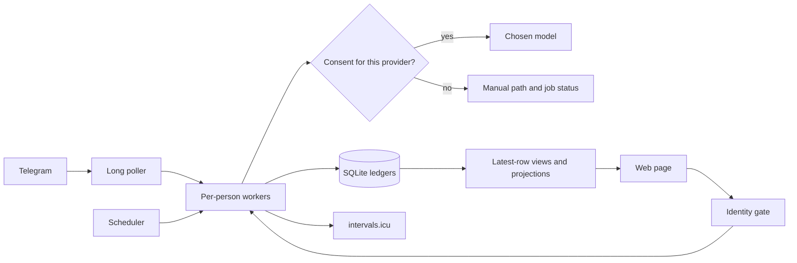

# Architecture

One `tiffin run` process holds the Telegram long poller, one worker lane per person, a scheduler and, when enabled, the FastAPI web page. Each database user opens a short-lived SQLite connection. The web page obtains person identity from the paired Telegram session or a trusted Tailscale header; requests cannot nominate another person.

Most tables are append-only ledgers with update and delete triggers. Corrections append a new row; readers select the latest applicable row. `db.PROJECTION_TABLES` and `db.STATE_TABLES` list the explicit exceptions. Timestamps use UTC space form, while household days use the configured time zone. Every scheduled job writes `run_ledger` as `ok`, `degraded`, `failed` or `skipped`; issues appear on the owner's status strip.

Onboarding first records provider consent when a model is configured, then gathers only the facts used by the target formula. It writes a profile, weigh-in and targets in that conversation. Optional answers are stored in the onboarding ledger and offered later by the daytime follow-up job, up to three questions in one prompt per day. Skipping keeps the profile default; `/followup` can answer a skipped question later. Jobs that use optional profile settings declare their defaults and record a degraded run while those answers are absent. Each job explains its defaults once in Telegram.

The food catalogue joins ingredient definitions to CoFID nutrient data. A model may choose indexes from numbered candidate lists or propose recipe structure, while code validates the choice and calculates grams times per-100 g nutrient values. The solver sizes portions against personal targets; pack-aware shopping rounds needed grams into purchasable packs and tracks leftovers. The model never performs trusted arithmetic. Without consent or a usable provider, work degrades to manual rather than silently disappearing.
